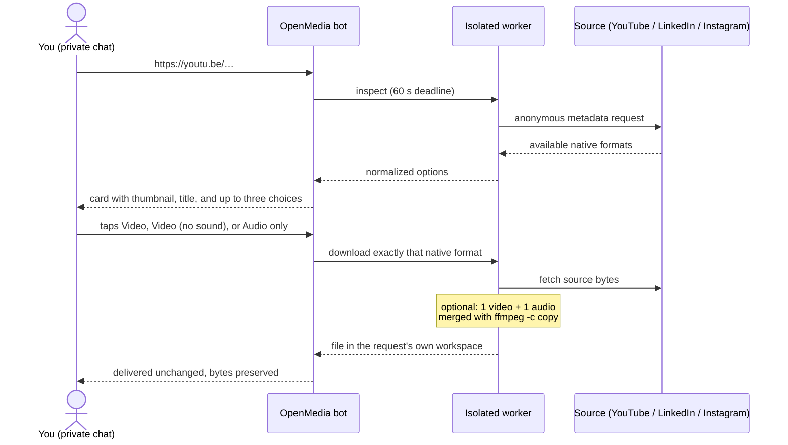
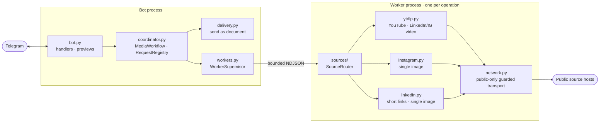

<div align="center">

# OpenMedia

**Send a link. Tap one plain choice. Get the original file, byte for byte.**

A self-hosted Telegram bot for public YouTube, LinkedIn, and Instagram media. It picks the
best native version the source offers for each choice and delivers it without re-encoding.

[](pyproject.toml)
[](LICENSE)
[](#project-status)

[How it works](#how-it-works) ·
[Quick start](#quick-start) ·
[Configuration](#configuration) ·
[Container](#container) ·
[Architecture](#architecture) ·
[Development](#development)

</div>

---

## Why OpenMedia

Most "download this video" bots pick a format for you, transcode it, and hand back whatever
fits. OpenMedia does the opposite:

- **Plain choices, native files.** A video gets at most three buttons: `Video`,
  `Video (no sound)`, and `Audio only`. Each one maps to a format the source publishes;
  nothing is transcoded, scaled, or converted. A picture needs no choice at all.
- **Byte-for-byte delivery.** Your choice is either one upstream file delivered unchanged,
  or exactly one video stream plus one audio stream joined with FFmpeg stream copy
  (`-c copy`) and labeled *combined*.
- **Anonymous access.** No accounts, logins, stored cookies, or operator-supplied
  credentials. If content needs a login, it is out of scope.
- **Nothing stored.** No database, no queue, no media library. Request state lives in
  bounded in-memory maps, and each job's workspace is deleted after delivery.
- **Bounded by design.** Fixed deadlines, capped concurrency, a per-job disk ceiling, and a
  guarded network layer that can only reach public addresses.

## How it works



When only one choice exists, or the post is a picture, the bot sends it without waiting for a
tap. Videos are uploaded with `sendVideo`, so they play in the chat. Pictures and audio go out
as Telegram *documents*, never as photos, because Telegram recompresses photos. In every case
the uploaded bytes are the downloaded file. Choices expire after 15 minutes, and the whole
download-and-send stage has 10 minutes to finish.

## Supported sources

| Source | Accepted links | Media | Live verification |
|---|---|---|---|
| YouTube | `youtube.com/watch?v=…`, `youtu.be/…`, `youtube.com/shorts/…` | Single video | Feasibility pass; full live suite pending |
| LinkedIn | `linkedin.com/posts/…`, `linkedin.com/feed/update/urn:li:…`, app share links `lnkd.in/p/…` | Video or single image | Video and image pass live through Telegram, including `lnkd.in` short links; full live suite pending |
| Instagram | `instagram.com/p/…`, `instagram.com/reel/…` | Video or single image | Video passes live through the product transport; single image pending |

**Out of scope:** playlists, live streams, carousels and multi-item posts, stories, private
or login-gated content, and any source not listed above. The bot explains each rejection, for
example *"Only one finished media item is supported. Send a single-item link."*

The "Live verification" column reflects recorded live runs, not what is expected to work.
Sources change without notice, so a category counts as supported only after it passes live.

## Project status

OpenMedia is **pre-release**. The planned features are implemented, and 623 controlled tests
cover them with the network disabled. The release gates that need the real world are still
open:

- [ ] Full live source suite, run through the product's own transport
- [ ] Constrained read-only container run with a real bot token (currently on hold)
- [ ] Deployment-network source checks and two-account Telegram acceptance
- [ ] Acceptance timing runs, 20 inspections plus 20 deliveries

No controlled test counts toward any of these gates. If you run the bot before they close,
treat it as a preview.

## Quick start

### Prerequisites

- [uv](https://docs.astral.sh/uv/) (it installs Python 3.13 for you)
- `ffmpeg` and `ffprobe` on `PATH`, used for stream-copy merges and output checks
- [Deno](https://deno.com/) on `PATH`, which yt-dlp uses to solve YouTube's JavaScript
  challenges
- A bot token from [@BotFather](https://t.me/BotFather)

Startup fails if any of the three executables is missing. The EJS challenge scripts come
from the lock through `yt-dlp[default]`. The [container image](#container) bundles all of
these, so you only need to install them yourself to run the bot outside Docker.

### Run locally

```sh
git clone https://github.com/hman-pro/openmedia.git
cd openmedia
uv sync --locked --group dev     # install from the lock

cp .env.example .env             # then set TELEGRAM_BOT_TOKEN in .env
uv run --locked --env-file .env python -m openmedia --check-config
uv run --locked --env-file .env python -m openmedia
```

On macOS, also set `OPENMEDIA_WORK_DIR=/private/tmp/openmedia` in `.env`. The default
`/tmp/openmedia` sits behind the `/tmp` symlink, and the bot refuses a symlinked workspace at
startup, even though `--check-config` passes.

`--check-config` validates the settings and the bundled runtime without connecting to
Telegram. Once the bot is running, open a private chat with it and send `/start` or a link.
The bot works only in private chats. If someone shares a link in a group, it replies with a
pointer to the private chat and never inspects the link.

## Configuration

Settings come from environment variables. `.env.example` is the annotated template.

| Variable | Default | Purpose |
|---|---|---|
| `TELEGRAM_BOT_TOKEN` | *(required)* | Bot API token. Never logged, never included in `repr` or error text. |
| `OPENMEDIA_WORK_DIR` | `/tmp/openmedia` | Root directory for per-request workspaces. |
| `OPENMEDIA_MAX_FILE_BYTES` | `50000000` | Delivery cap. Telegram's hosted Bot API limits uploads to 50 MB. |
| `OPENMEDIA_MAX_WORKERS` | `2` | Concurrent inspect and download slots. At most one Instagram job runs at a time. |
| `OPENMEDIA_MAX_PENDING` | `100` | Previews waiting for a selection. Beyond this, new requests are rejected immediately. |
| `OPENMEDIA_WORKSPACE_BYTES` | `134217728` | Disk ceiling per job (128 MiB). |
| `OPENMEDIA_LOG_LEVEL` | `INFO` | Console log level. |
| `OPENMEDIA_DIAGNOSTIC_LOG` | `0` | Set to `1` to enable the [diagnostic log](#diagnostic-log-development). |
| `OPENMEDIA_DIAGNOSTIC_LOG_DIR` | `/var/log/openmedia` | Diagnostic log directory. Must be an absolute path outside `OPENMEDIA_WORK_DIR`. |
| `OPENMEDIA_DIAGNOSTIC_LOG_LEVEL` | `DEBUG` | `CRITICAL`, `ERROR`, `WARNING`, `INFO`, or `DEBUG`. |

The deadlines are acceptance values fixed in code and have no environment variables:
**60 s** inspect, **900 s** selection expiry, **600 s** download-and-send, and **900 s**
cleanup.

To raise the 50 MB delivery cap you would need a self-hosted Telegram Bot API server. That
adds a second service, which this project deliberately does not run.

## Container

```sh
docker build --tag openmedia:local .
docker run --rm --env-file .env \
  --read-only --cpus=2 --memory=2g \
  --tmpfs /tmp:rw,noexec,nosuid,size=536870912,mode=1777 \
  -e OPENMEDIA_DIAGNOSTIC_LOG=1 -v openmedia-logs:/var/log/openmedia \
  openmedia:local python -m openmedia --check-config
```

Drop `--check-config` to start the bot. The image:

- runs as UID/GID `10001`, exposes no ports, and runs with a read-only root filesystem;
- bundles EJS, Deno, and FFmpeg, and downloads no executables at runtime;
- defines a `HEALTHCHECK` that runs `python -m openmedia --healthcheck`.

The last two flags in the example turn the diagnostic log on and mount a named volume for it,
because the image filesystem is read-only. Drop both to run with the log off. Deployment,
live-source, real-Telegram, and timing checks remain separate release gates (see
[Project status](#project-status)).

> **Redistributing the image?** It contains a GPL-2.0-or-later FFmpeg build and other
> copyleft components. [`THIRD_PARTY_NOTICES.md`](THIRD_PARTY_NOTICES.md) lists your
> source-availability obligations.

## Diagnostic log (development)

This log is off by default. Turn it on while you trace a problem:

```sh
export OPENMEDIA_DIAGNOSTIC_LOG=1
export OPENMEDIA_DIAGNOSTIC_LOG_DIR="$PWD/logs"   # absolute, outside OPENMEDIA_WORK_DIR
uv run --locked --env-file .env python -m openmedia
```

The bot writes one JSON Lines file per UTC day, named `logs/openmedia-YYYY-MM-DD.log`. Every
stage of a request shares one `request_id`:

```sh
f="logs/openmedia-$(date -u +%F).log"
jq -r 'select(.stage=="received") | [.ts, .request_id, .source_url] | @tsv' "$f"
grep -h <request_id> logs/openmedia-*.log | jq -c '{ts, stage, outcome, error_category}'
jq -c 'select(.level=="ERROR")' "$f"
```

> [!WARNING]
> The files contain submitted links, including those in refused messages, and Telegram chat
> and user identifiers. They are kept
> for at most 14 day files and 50 MB in total. The console never shows these values. The bot
> token, signed media URLs, and media bytes are never written.

`OPENMEDIA_DIAGNOSTIC_LOG_LEVEL` (default `DEBUG`) sets how much detail is logged.

## Architecture

One Python process runs the bot. Every source operation runs in a short-lived child process.



| Layer | Modules | Responsibility |
|---|---|---|
| Runtime & configuration | `__main__`, `config`, `diagnostics` | Composition root, validated `Settings`, CLI modes (`--check-config`, `--healthcheck`), opt-in diagnostic log |
| Telegram interface | `bot`, `presentation`, `delivery` | Parse links from private chats, render the choice card, deliver files unchanged, map errors to user guidance |
| Request orchestration | `coordinator`, `workers`, `models` | Atomic capacity reservation with no waiting, request lifecycle and deadlines, child-process supervision, immutable domain models |
| Source adapters & network | `sources/*`, `network` | Link recognition, per-source adapters, FFmpeg stream-copy merge, DNS-pinned public-only HTTP with bounded redirects and sizes |

A few design choices are worth knowing before you change code:

- **Callback data is a small integer.** Inline-keyboard buttons carry only an `option_id`,
  which the bot maps back to a format on the server side. A URL, extractor expression, or
  path never travels through Telegram.
- **Workers see as little as possible.** Each operation gets a minimal environment, its own
  process group, and its own workspace, and it talks to the parent only through a bounded
  newline-delimited JSON protocol.
- **The network layer allows only public addresses.** It resolves DNS itself, pins the
  connection to the resolved address, and refuses private, loopback, and link-local targets.
  This protects against SSRF through redirects.
- **FFmpeg reads only local files.** Merging uses `-c copy` with `-protocol_whitelist file`,
  so a crafted input cannot make it fetch anything.
- **YouTube uses `player_client=default,android`.** `default` supplies fetchable adaptive
  streams, and `android` provides the source-muxed format 18. `ios` serves only SABR streams
  and cannot be fetched. Change the list only with fresh live evidence.

## Development

### Testing

```sh
uv sync --locked --group dev
uv run --locked pytest tests/unit tests/contract tests/integration   # controlled gate
uv run pytest -m live                                                # opt-in, real sources
```

- **Controlled tests** (`unit/`, `contract/`, `integration/`) run with the network disabled
  in `tests/conftest.py`. They use a fake Telegram transport, a manually advanced clock, and
  sanitized fixtures whose provenance is documented next to them.
- **Live tests** (`tests/live/`) reach real sources, sit behind the `live` marker, and are
  excluded by default. They need a private manifest outside the repository, named by
  `OPENMEDIA_LIVE_MANIFEST`; `tests/fixtures/live-sources.example.json` shows its shape. Run
  them deliberately and space out Instagram cases.


### Repository layout

```text
src/openmedia/          application package
  sources/              link routing and per-source adapters
tests/
  unit/ contract/ integration/   controlled suites (network disabled)
  live/                          opt-in real-source checks
  fixtures/                      sanitized fixtures with PROVENANCE.md
specs/                  Spec Kit specifications, plans, contracts, validation
Dockerfile              multi-stage build: uv, Deno, runtime
```

## Contributing

Issues and pull requests are welcome. Start with the relevant spec and contract. A change
that adds a service, a dependency, a platform, or a new kind of source access is a scope
decision, and it belongs in the spec before it goes into the code. Before you open a pull
request:

1. Run the controlled gate and make sure it passes.
2. Add or update tests at the layer you touched.
3. Keep the bot token, links, and Telegram identifiers out of console logs, `repr`, and
   error text. Links and identifiers may be written only through the `openmedia.diagnostic`
   logger.

## Responsible use

OpenMedia fetches only content that is publicly reachable without logging in. You are still
responsible for how you use it. Respect the terms of service of each source and the rights
of the people who created the content, and run your own instance only where doing so is
lawful.

## License

OpenMedia is released under the [MIT License](LICENSE). Third-party components, including the
copyleft ones bundled in the container image, keep their own licenses. See
[`THIRD_PARTY_NOTICES.md`](THIRD_PARTY_NOTICES.md).
