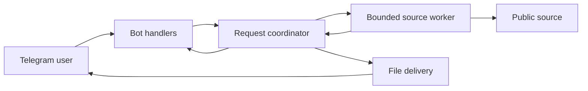

# Implementation Plan: Media Download Workflow

**Branch**: `main` | **Date**: 2026-09-15 | **Spec**: [spec.md](spec.md)

**Input**: Feature specification from `specs/001-media-download/spec.md`.
Spec Kit reports feature identifier `001-media-download`; the actual Git branch is `main`.
Feature discovery uses `.specify/feature.json`, independently of branch naming.

## Summary

Build a publicly accessible Telegram bot: accept one public media link, inspect metadata,
show native-format choices, download only after selection, and deliver the unchanged file
in the requesting private chat. Use Python 3.13 and python-telegram-bot with long polling
in one container. Reuse yt-dlp for video/native audio and Instaloader for Instagram images;
a narrow LinkedIn image parser covers the gap in those libraries.

The design retains all five platform/media combinations in FR-002. Research establishes
source-code feasibility; live support must still pass the release matrix. There are no
remaining product questions, and no implementation has been performed by this plan.

## Technical Context

**Language/Version**: Python `>=3.13,<3.14`; Linux container with pinned base image.

**Primary Dependencies**: python-telegram-bot 22.8, yt-dlp[default] 2026.8.19,
Instaloader 4.15.3; Deno 2.x (at least 2.3.0) for bundled YouTube challenge scripts.
Standard-library HTML parsing and guarded HTTP for LinkedIn images. See the dependency
and license decisions in [research.md](research.md).

**Storage**: In-memory request maps and bounded terminal tombstones; temporary files only.
No database, durable queue, media archive, or cross-user download cache.

**Testing**: pytest/pytest-asyncio with mocked Telegram transport and sanitized source
fixtures; opt-in live source checks and separate interactive Telegram acceptance.

**Target Platform**: One Linux container, initially 2 CPUs, 2 GiB RAM, 512 MiB temporary
filesystem; no inbound port. Local development uses Python 3.13 and uv.

**Project Type**: Telegram bot service with subprocess source workers.

**Performance Goals**: SC-002 acknowledgment within 2 seconds and preview within 30 seconds
in 95% of 20 eligible requests; SC-003 delivery within 2 minutes for eligible files up to
20 MB. Benchmark within the configured work-slot limit with responsive external services.

**Constraints**: Native source formats only; no transcoding, merging, remuxing, credentials,
playlists, or multi-item posts. Application delivery cap 50,000,000 bytes. Inspection 60s,
selection expiry 900s, selected download plus sending 600s, cleanup within 900s. Public bot
access with one active request per user and no silent job queue.

**Scale/Scope**: One replica; two active work slots, one Instagram work slot, 100 pending
previews; 1,000 terminal tombstones maximum with 900s TTL. Five required combinations:
YouTube video, LinkedIn video/image, Instagram video/image; native audio where exposed.

## Constitution Check

*Pre-research and post-design review; these are design checks, not executed release tests.*

| Gate | Before research | After design | Evidence |
|---|---|---|---|
| I. Social media downloading | Pass: user journey and media matrix defined | Pass: all categories retained with explicit adapter paths | Source contract and platform acceptance matrix |
| II. Telegram interface | Pass: link-to-file private-chat flow | Pass: handlers separated from source workers | Telegram contract; coordinator boundary |
| III. Python by default | Pass: Python requested | Pass: one Python service; Deno only supports yt-dlp | Technical Context; research §1 and §7 |
| IV. Open source reuse | Pass: evaluate existing extractors first | Pass: reuse two libraries; narrow image parser justified by missing support and optional-metadata semantics | Research §6; dependency notices |
| V. Container deployment | Pass: one container is sufficient | Pass: bounded temporary filesystem, runtime token, image and startup checks specified | Quickstart and runtime contract |
| Resource limits and credentials | Pass: spec specifies deadlines and access mode | Pass: capacity, kill/reap, cleanup, redaction, public-destination checks | Runtime and source contracts |
| Feature validation | Pass: measurable acceptance criteria exist | Pass: deterministic checks plus independent live gates defined | Quickstart; SC-001–SC-007 mapping |

No constitution exception is required. Release is not complete until source compatibility,
network restrictions, dependency resolution, image startup, and workflow checks actually pass.

## Project Structure

### Documentation (this feature)

```text
specs/001-media-download/
├── spec.md
├── plan.md
├── research.md
├── data-model.md
├── quickstart.md
├── checklists/requirements.md
└── contracts/
    ├── telegram-bot.md
    ├── source-adapters.md
    └── runtime.md
```

`tasks.md` is the next phase's output and is not generated by this command.

### Source Code (repository root)

The repository currently contains specification tooling and documents. The following is
the proposed implementation layout, not a claim that these files already exist.

```text
pyproject.toml
uv.lock
Dockerfile
.dockerignore
.env.example
THIRD_PARTY_NOTICES.md
src/openmedia/
├── __init__.py
├── __main__.py          # Startup, polling, lifecycle, --check-config, --healthcheck
├── config.py
├── models.py
├── bot.py               # Message/callback handling and presentation
├── coordinator.py       # Request ownership, capacity, expiry, rate/cooldown state
├── workers.py           # Child protocol, deadline enforcement, process-group cleanup
├── delivery.py          # File attachment upload and uncertainty handling
├── network.py           # Shared public-destination and bounded transfer controls
└── sources/
    ├── __init__.py      # Routing and normalized adapter contract
    ├── ytdlp.py
    ├── instagram.py
    └── linkedin.py
tests/
├── unit/                # Ownership, formatting, deadlines, resource admission
├── contract/            # Source fixtures, network guards, Telegram message contracts
├── integration/         # Complete mocked flows and actual worker termination
├── live/                # Opt-in source checks; no automatic Telegram sends
└── fixtures/            # Sanitized HTML/metadata, tiny licensed media, manifest example
```

**Structure Decision**: A single package keeps the bot deployable as one process group.
Three source adapters normalize upstream responses; the coordinator owns behavior common
to all platforms. Use small concrete modules, not a plugin framework or generic repository
layer. Detailed entity and transition definitions are in [data-model.md](data-model.md).

### Execution and ownership



Handlers validate input, reserve state under a per-user lock, and schedule supervised work;
they never await a full download. Limit concurrent update handlers to 8 and Telegram HTTP
connections to 16 with a separate polling connection. Admission uses nonwaiting work-slot
reservation so overload returns the documented busy outcome. Pending previews occupy no
worker slot. Callback identity checks and state transition happen atomically before work.

Each inspection/download starts a short-lived worker, with a bounded JSON event protocol.
Only the parent knows the bot token or Telegram identifiers. A worker failure releases its
slot even if Telegram notification fails. Kill and reap the process group before deleting
its workspace. Parent-owned Instagram rate state coordinates successive workers. No raw
upstream commands, URLs, or executable options are accepted from callback data.

### Delivery order and verification

Implementation should first verify the five source/media paths with metadata-only fixtures
and credential-free live examples, then build the coordinator, Telegram interactions, and
container. Source support failures must be resolved or explicitly escalated as scope changes;
an error message alone does not count as support for a required category.

| Requirements | Planned verification |
|---|---|
| FR-001, FR-003–FR-005, FR-016 | Input and preview contracts, optional metadata, first-time users |
| FR-002, FR-006 | All source/media fixture categories; exact source option and native bytes |
| FR-007–FR-009 | No download before selection; selected file and destination; confirmed send |
| FR-010–FR-011 | Known/unknown size, unavailable source, timeout, blocked bot, ambiguous send |
| FR-012–FR-013 | Repeated callbacks, two users, replacement races, saturation, stale state |
| FR-014–FR-015 | Accelerated-clock expiry; real child termination; cleanup and restart |
| SC-001–SC-007 | Quickstart acceptance matrix and recorded timing runs |

## Complexity Tracking

No constitution violations. The LinkedIn image adapter is justified reuse-gap work under
Principle IV; its bounded scope and alternatives are documented in research §6. The native
format decision avoids an FFmpeg dependency. Multiple services or durable state require a
future requirement and plan revision.
