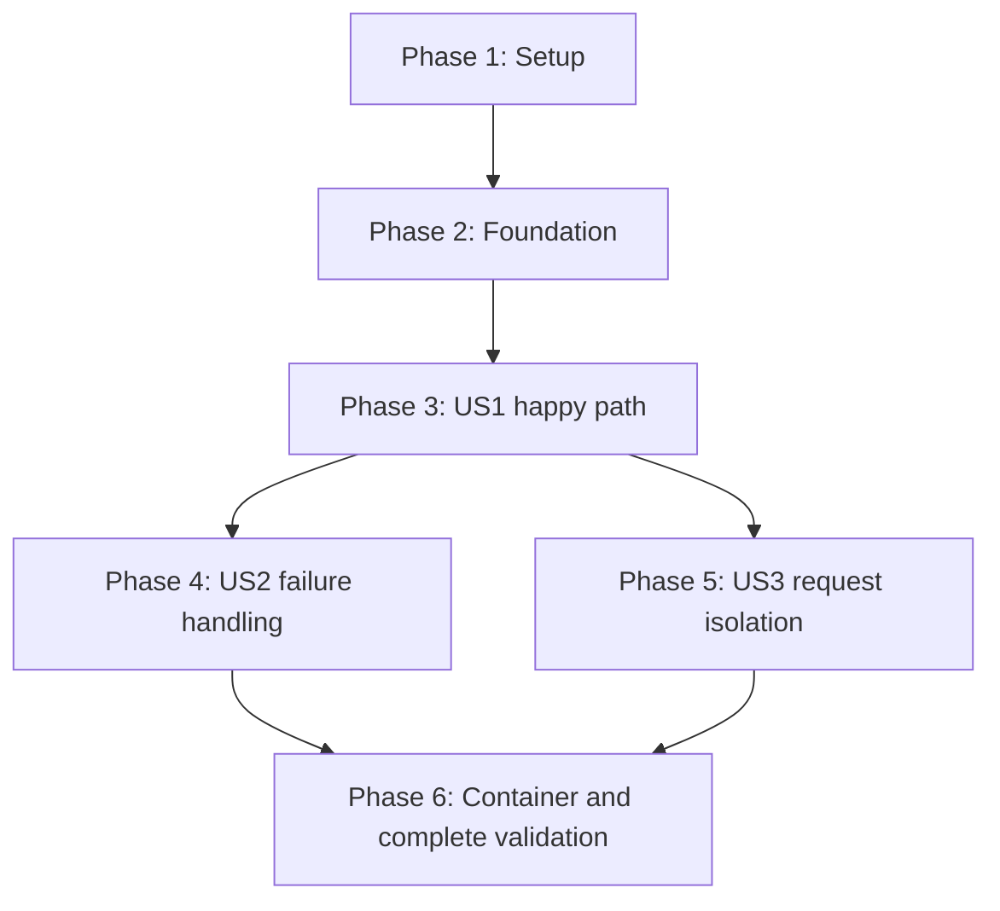

# Tasks: Media Download Workflow

**Input**: Design documents from `specs/001-media-download/`

**Prerequisites**: [plan.md](plan.md), [spec.md](spec.md), [research.md](research.md),
[data-model.md](data-model.md), [contracts/](contracts/), [quickstart.md](quickstart.md).

**Tests**: Included to implement the specification's acceptance checks (SC-001–SC-007),
the constitution's validation requirements, and the plan's controlled/live test strategy.
Write story acceptance tests before the corresponding behavior and observe the expected
failure; do not require unrelated tests or a blanket coverage percentage.

**Organization**: Three user stories, in priority order: US1 happy path (P1), US2 failure
handling (P2), US3 request isolation (P2). Supporting infrastructure is shared. No application
code is implemented by task generation; every task starts unchecked.

## Format: `[ID] [P?] [Story] Description`

`[P]` means different files permit parallel work after the dependencies listed below are
complete. Story phases require `[US1]`, `[US2]`, or `[US3]`. All file paths are relative to
the repository root. A reference to a validation report is a concrete output to create/update,
not a substitute for running the stated check.

## Path Conventions

Application: `src/openmedia/`; tests: `tests/`; feature documents:
`specs/001-media-download/`. Follow the single-package layout in `plan.md`. No database,
queue service, web server, FFmpeg, conversion pipeline, or public deployment is included.

## Phase 1: Setup (Shared Infrastructure)

**Purpose**: Establish a reproducible Python package and controlled validation environment.

- [ ] T059 [P] Run a timeboxed source feasibility spike before Phase 2, outside `src/` and without committing downloaded media: for one credential-free example per FR-002 category, run metadata-only inspection (`yt-dlp -J <url>` for video; Instaloader `Post.from_shortcode` for Instagram images; fetch the LinkedIn public embed HTML and confirm one explicit image attachment). Record per category in `specs/001-media-download/validation.md`: anonymous access result, network location, candidate format `protocol` values, whether a combined video-with-sound format exists, and blockers. Space Instagram requests at least 60s apart. A category without anonymous access stops Phase 2 pending an explicit scope decision.
- [ ] T001 Initialize the Python `>=3.13,<3.14` package and module entry point in `pyproject.toml`, `src/openmedia/__init__.py`, `src/openmedia/__main__.py`, and `src/openmedia/sources/__init__.py`, using the layout in `plan.md` without implementing user workflows yet.
- [ ] T002 Declare python-telegram-bot `==22.8`, yt-dlp[default] `==2026.8.19`, Instaloader `==4.15.3`, and the planned pytest/pytest-asyncio dev group in `pyproject.toml`; resolve exact compatible dependencies into `uv.lock`, verify `uv sync --locked --group dev`, and record any compatibility failure in `specs/001-media-download/validation.md` instead of silently changing the stack.
- [ ] T003 [P] Configure `.gitignore` and `.dockerignore` to exclude `.env`, credentials, local live manifests, downloaded media, caches, `.git` from images, and unnecessary fixture/build artifacts while retaining versioned sanitized test fixtures in Git.
- [ ] T004 [P] Establish network-disabled controlled tests, fake Telegram transport, monotonic-clock helpers, and licensed tiny-media fixture conventions in `tests/conftest.py` and `tests/fixtures/README.md`; register the explicit `live` marker in `pyproject.toml` and keep live credentials outside test defaults.

**Checkpoint**: Package installs from the lock; controlled tests cannot accidentally call
Telegram or social sources. Dependencies: T001 → T002 → {T003, T004}.
T059 has no prerequisites and may run alongside T001–T004; Phase 2 starts only after T059
records an anonymous pass per category or an approved scope decision.

---

## Phase 2: Foundational (Blocking Prerequisites)

**Purpose**: Provide the bounded, typed interfaces all three stories use. Complete this phase
before story implementation. The quoted constraints below come from `data-model.md`.

- [ ] T057 Write configuration unit tests in `tests/unit/test_config.py`: missing token, token absent from repr/str/error text, nonpositive limits, `OPENMEDIA_WORKSPACE_BYTES` not exceeding `OPENMEDIA_MAX_FILE_BYTES`, invalid log level, and rejection of environment overrides for the fixed 60s/900s/600s/900s deadlines (FR-014; constitution credential rules).
- [ ] T005 Implement runtime settings and redacted validation in `src/openmedia/config.py` and `.env.example` using `contracts/runtime.md`: required runtime token, owned work directory, 50,000,000-byte file ceiling, two workers, 100 pending previews, 128 MiB workspaces, INFO logging, and fixed 60s/900s/600s/900s deadlines; reject invalid/contradictory values and exclude tokens from object representations; pass T057.
- [ ] T006 Define DownloadRequest in `src/openmedia/models.py` with the exact field constraints: request_id "Random 128-bit identity, encoded as 32 hex characters; never reused"; user_id/chat_id "Telegram integer identities; private chat required; do not infer ownership from username"; source_url/platform/media_id "Validated canonical public source; recognized route and stable source item identity"; state "checking, awaiting_selection, downloading, sending, completed, failed, expired, replaced"; metadata "Optional MediaMetadata, populated by successful inspection"; options "Ordered FormatOption records bound to this request; immutable after preview"; selected_option_id "Null until one valid callback atomically claims the request"; created_at/preview_expires_at/processing_deadline "Monotonic deadlines internally; UTC timestamps only for diagnostics"; preview_message_id "Message owning the format keyboard; callbacks must match"; work_directory/worker_pid "Internal handles only; no caller-supplied paths; absent while idle"; delivery_result "Optional DeliveryResult".
- [ ] T007 Define MediaMetadata in `src/openmedia/models.py`: `platform`, `canonical_url`, and `media_id` identify the item; "Optional `title_or_caption`, `creator`, `duration_seconds`, and `thumbnail_url` carry available descriptive information"; "Duration is nonnegative and absent for images"; `media_count` and `media_kind` distinguish one video/image from collection/live content; preserve "Never infer a creator or title from missing data" and reject wrappers that hide playlists/carousels by selecting their first child.
- [ ] T008 Define FormatOption in `src/openmedia/models.py` with option_id "Stable integer within one request; mapped on the server, never accepted as a raw extractor expression"; adapter/source_format_id "Selected extractor and exact upstream identifier or immutable image identity"; media_type "video, audio, image"; extension/mime_type "Supported native file format; detected/validated rather than trusting a filename"; width/height/bitrate "Optional quality descriptors; positive when supplied"; includes_audio "True/false for video; absent when not applicable"; size_bytes/size_kind "Nonnegative byte count or null; exact, estimated, or unknown"; transport_ref "Private upstream URL/headers or extractor reference; never emitted in callback data or logs"; availability "selectable or excluded, with a user-facing reason"; preserve "A selectable option must be producible without conversion or merging" and "Never choose a different option on retry".
- [ ] T009 Define DeliveryResult in `src/openmedia/models.py`: "`status` is confirmed, failed, or unknown"; "A confirmed result contains the returned Telegram `message_id` and actual byte count"; "Failed/unknown results record a sanitized error category, failed stage, and next-step text"; "`notification_sent` is a boolean"; an ambiguous upload leaves the request failed with result unknown, never a claim of confirmed non-delivery.
- [ ] T010 Define normalized inspect/download inputs, outputs, and error categories in `src/openmedia/sources/__init__.py`, matching `contracts/source-adapters.md`; expose fixed operations only and a transport/rate-control interface so adapters can be developed without Telegram dependencies.
- [ ] T011 Write network-boundary tests in `tests/contract/test_network.py` for redirects, DNS rebinding, TLS hostname verification, private/link-local/loopback destinations, URL userinfo, proxy environment, response-size limits, chunked downloads, symlink/traversal output paths, and sensitive header removal on host changes; keep all destinations simulated or explicitly test-owned.
- [ ] T012 Implement shared guarded metadata/image/thumbnail transport and file validation in `src/openmedia/network.py`: validate/pin public resolved endpoints before every connection, permit at most five redirects, bound metadata to 8 MiB and separate thumbnails to 1 MiB, enforce actual download/workspace bytes, and validate regular files inside the request-owned directory; pass T011 before adapter integration.
- [ ] T013 Write worker-protocol and actual subprocess lifecycle tests in `tests/integration/test_workers.py` for fixed operations, 2 MiB result limits, minimal environment without bot token/user IDs, malformed/multiple terminal events, bounded stderr/progress, kill/reap, and no writes after timeout; use a controlled test worker fixture in `tests/fixtures/worker_stub.py`.
- [ ] T014 Implement supervised source workers in `src/openmedia/workers.py` with bounded newline-delimited JSON, inspect/download dispatch, progress/rate_request/rate_limited/result/error events, parent rate-control replies, per-request scratch directories, argument-array spawning, minimal environment, process-group termination, and five-second cancellation/reaping reserve inside each total deadline; pass T013.
- [ ] T015 Implement shared request registry and lifecycle primitives in `src/openmedia/coordinator.py`: `requests_by_id`/`active_request_by_user`, per-user locks, atomic state/capacity reservation, two nonwaiting work slots, one Instagram slot, pending-preview reservation capped at 100, stale-worker publication guards, and release/finalize primitives; preserve "If capacity is full, preserve the current preview" and "Notification failure cannot prevent finalization" from `data-model.md`.

**Checkpoint**: Models, guarded network access, worker termination, and shared ownership
primitives are ready. Foundation checks are runnable without live sources or a bot token.
Model edits T006–T009 are sequential because they share `models.py`.

---

## Phase 3: User Story 1 - Choose and Receive Media (Priority: P1) — MVP

**Goal**: Any Telegram user submits one public link, sees metadata and native format choices,
selects one, and receives that exact file in the same private chat.

**Independent Test**: For each of the five platform/media combinations, prove inspection
causes no primary media download, then explicitly select one offered native option and
verify file identity/format and destination. Include one-choice previews, absent metadata,
first-time users, native audio when exposed, and silent-video labeling.

### Tests for User Story 1

- [ ] T016 [P] [US1] Add yt-dlp contract tests and sanitized metadata fixtures in `tests/contract/test_ytdlp.py` and `tests/fixtures/ytdlp/` for YouTube/LinkedIn/Instagram video, explicit native format IDs, audio-only and silent video, metadata-only inspection, and rejecting conversion/merge-only choices and non-allowlisted protocols (FR-002, FR-006, FR-007).
- [ ] T017 [P] [US1] Add Instagram image contract tests and provenance-documented fixtures in `tests/contract/test_instagram.py` and `tests/fixtures/instagram/` for GraphImage native URLs, missing metadata, GraphSidecar rejection, and image media versus thumbnail identity (FR-002, FR-004, FR-006).
- [ ] T018 [P] [US1] Add LinkedIn image parser contract tests and provenance-documented guest-page fixtures in `tests/contract/test_linkedin.py` and `tests/fixtures/linkedin/` for matching activity ID, one explicit feed-image attachment, missing creator/caption, multiple images, absent/mismatched identity, and avatar/article/OG-preview rejection (FR-002, FR-004).
- [ ] T019 [P] [US1] Add Telegram preview/selection contract tests in `tests/contract/test_bot_preview.py` for public private-chat access, one supported-platform link with surrounding text and unrelated URLs, optional metadata, worker-provided or absent thumbnail, native labels and size certainty, eight-option pagination, explicit selection even for one choice, compact callbacks, and no required /start command (FR-001, FR-003–FR-007, FR-016).
- [ ] T020 [P] [US1] Add a mocked end-to-end happy-path suite in `tests/integration/test_download_flow.py` proving no media download before selection, exact selected file bytes/format and originating chat on delivery, status ordering, and completion only after a returned Telegram Message (FR-007–FR-009; SC-001, SC-006).
- [ ] T058 [P] [US1] Write link and label unit tests in `tests/unit/test_links.py` and `tests/unit/test_option_labels.py`: supported-platform link counting (per FR-001), canonical route recognition for the five categories, collection/live route rejection, option ordering (video with sound, audio, silent video, image; quality descending), and exact/estimated/unknown size labels (FR-001, FR-002, FR-005).

### Implementation for User Story 1

- [ ] T021 [P] [US1] Implement video/native-audio inspection and exact-format downloads in `src/openmedia/sources/ytdlp.py`, using guarded networking and parent rate events, bundled EJS plus restricted Deno, explicit site extractors and format IDs, no generic fallback/config/cookies/plugins/postprocessors/external downloaders, and protocol allowlist filtering per `contracts/source-adapters.md`; pass T016.
- [ ] T022 [P] [US1] Implement Instagram image inspection and selected-image downloading in `src/openmedia/sources/instagram.py` with Instaloader post classification, guarded transport, parent-owned rate-control callbacks, original source format, optional metadata, and no primary-image fetch during inspection; pass T017.
- [ ] T023 [P] [US1] Implement the narrow LinkedIn public-embed image adapter in `src/openmedia/sources/linkedin.py` using the reviewed attachment parser approach, strict requested activity identity, exactly one explicit attachment, optional descriptive metadata, guarded networking, and original-format download after selection; record any reused source commit/attribution in the module and pass T018.
- [ ] T024 [US1] Integrate recognized source routes and normalized media classification in `src/openmedia/sources/__init__.py` and worker dispatch in `src/openmedia/workers.py`; connect all three adapters, reject collections/live items without flattening, keep native options stable, and prove every adapter/redirect uses guarded transport in `tests/contract/test_adapter_transports.py`; fetch the separate thumbnail URL inside the inspect worker through guarded transport and return an optional validated image file, where thumbnail failure omits the thumbnail without failing inspection.
- [ ] T025 [US1] Create opt-in live source validation in `tests/live/test_sources.py` and `tests/fixtures/live-sources.example.json` with case_id/platform/media_type/url/expected identity, covering all five combinations; inspect before explicit small-file selection, clean files, skip with a reason when the manifest is absent, and never send Telegram messages from this suite.
- [ ] T026 [US1] Run the early five-category source feasibility check through `tests/live/test_sources.py` using a private manifest and record source identity, versions, native output, access conditions, results, and blockers in `specs/001-media-download/validation.md`; require a passing example per category before marking this task complete, and keep credential-required/unavailable categories open rather than counting error handling as media support.
- [ ] T027 [US1] Implement input parsing, optional /start and /help, private-chat guidance, metadata previews, upload of the worker-provided thumbnail file (no network fetch from `bot.py`), source-native option labels, and eight-option keyboards in `src/openmedia/bot.py` according to `contracts/telegram-bot.md`; preserve unknown/estimated size, optional metadata, and explicit selection; pass T019 and T058.
- [ ] T028 [US1] Wire inspection → awaiting selection → exact selected download → sending in `src/openmedia/coordinator.py`, using the foundation's atomic ownership/capacity primitives; end requests on invisible/failed previews, retain the one 600s processing deadline, validate selected output identity/type/format/quality, and never auto-select or substitute a format.
- [ ] T029 [US1] Implement native-byte `sendDocument` upload in `src/openmedia/delivery.py`, checking actual size and path before sending, recording returned message ID only on confirmed success, and never retrying an ambiguous upload; connect it to coordinator completion and immediate success cleanup.
- [ ] T030 [US1] Implement application startup and polling in `src/openmedia/__main__.py`: redacted configuration/runtime checks, token usability, pending-update discard, eight bounded handlers, HTTP pool of 16 plus polling connection, tracked background tasks, structured stage logs (including upstream status class per request), and per-chat/global ordinary-send limits of 1/s and 20/s with prompt callback acknowledgments.
- [ ] T031 [US1] Run T016–T020, T058, and `tests/contract/test_adapter_transports.py` against the integrated workflow, correct happy-path defects in the responsible `src/openmedia/` modules, and record passing fixture coverage and the US1 independent test in `specs/001-media-download/validation.md`; distinguish controlled coverage from T026 live evidence.

**Checkpoint**: US1 is runnable as a local bot and independently demonstrable. The entire
FR-002 matrix remains part of the MVP; a YouTube-only demo is an intermediate checkpoint,
not permission to remove image or platform support. Failure hardening, full race behavior,
and container acceptance are still required before release.

---

## Phase 4: User Story 2 - Understand an Unsuccessful Request (Priority: P2)

**Goal**: Every rejected or failed operation ends with the correct stage/reason and next step
when communication is available, and frees work/resources even when notification fails.

**Independent Test**: Inject invalid/multiple links, unsupported/private/removed content,
missing formats, known/unknown oversize files, storage exhaustion, changed formats, timeouts,
blocked bot, and ambiguous upload; confirm terminal state, accurate messaging, no substitution,
no duplicate upload, cleanup, and successful admission of a subsequent valid request.

### Tests for User Story 2

- [ ] T032 [P] [US2] Add invalid-input/source-failure contract tests in `tests/contract/test_bot_errors.py` for every error category in `contracts/telegram-bot.md`, unsupported redirects, two supported-platform links (including playlist plus video), groups, collections/live posts, unavailable native audio, no formats, and first-time-user recovery without exposing raw exceptions (FR-001, FR-010–FR-011).
- [ ] T033 [P] [US2] Add failure/cleanup integration tests in `tests/integration/test_failure_cleanup.py` for 60s inspection and 600s processing deadlines with five-second reap reserve, storage exhaustion, malformed worker output, real process-group timeout, 900s cleanup ceiling, startup leftovers, and failed notifications (FR-014–FR-015; SC-004, SC-007).
- [ ] T034 [P] [US2] Add upload-outcome tests in `tests/contract/test_delivery_errors.py` for confirmed rejection, blocked bot, rate-limit retry within remaining deadline, uncertain network outcome, original-format/size mismatch, and absence of automatic duplicate sends (FR-009–FR-011).

### Implementation for User Story 2

- [ ] T035 [US2] Implement single bounded signed-URL refresh and exact-option revalidation across `src/openmedia/sources/ytdlp.py`, `src/openmedia/sources/instagram.py`, and `src/openmedia/sources/linkedin.py`; enforce media ID/format/quality/audio equality, stop on unsupported native transport or changed format, exclude known exact oversized choices, and cap actual bytes for estimated/unknown sizes without conversion or next-best fallback.
- [ ] T036 [US2] Implement stage-specific failure presentation and recovery guidance in `src/openmedia/bot.py`, mapping sanitized adapter/worker/delivery categories to the Telegram contract, preserving usable alternatives, and ensuring notification failure never blocks coordinator finalization; pass T032.
- [ ] T037 [US2] Complete resource-failure, deadline, and cleanup paths in `src/openmedia/workers.py` and `src/openmedia/coordinator.py`: kill/reap before removing files, release slots/reservations on every outcome, remove temporary media immediately or by the 60s sweeper within 900s, and schedule startup cleanup before readiness; pass T033.
- [ ] T038 [US2] Complete delivery failure handling in `src/openmedia/delivery.py`: retry only definite retry-after rejections inside the existing deadline, classify ambiguous upload as unknown, ask users to check the chat before resubmission, close file handles on cancellation, and avoid further upload attempts after uncertainty; pass T034.
- [ ] T039 [US2] Extend `tests/contract/test_adapter_transports.py` and `tests/integration/test_failure_cleanup.py` to prove all real adapter transport bindings enforce public-destination checks, 8 MiB metadata/1 MiB thumbnail bounds, 50,000,000 output bytes/128 MiB workspaces, safe output paths, and no token or signed-URL leakage; fix defects in the responsible existing transport/worker module.
- [ ] T040 [US2] Run the US2 independent test and existing US1 suites, resolve regressions in the responsible `src/openmedia/` files, and record failure classifications, cleanup evidence, and continued happy-path operation in `specs/001-media-download/validation.md`.

**Checkpoint**: Failure handling is independently verifiable using injected errors; no live
outage or private account is needed to validate these behaviors.

---

## Phase 5: User Story 3 - Keep Requests and Selections Unambiguous (Priority: P2)

**Goal**: Keep each request owned by its user/chat, prevent duplicate processing, and provide
consistent busy/replaced/expired responses under concurrent messages and restarts.

**Independent Test**: Two users act concurrently, repeat/forge callbacks, replace a pending
link, submit links during active work, hit global/Instagram capacity, and use expired or
restart-invalidated buttons; verify atomic ownership, zero cross-user deliveries/duplicate
work, preserved pending choices on overload, and bounded retained state.

### Tests for User Story 3

- [ ] T041 [P] [US3] Add coordinator race/capacity/retention tests in `tests/integration/test_request_isolation.py` for two users, duplicate selection versus new-link replacement, stale-worker results, one user slot/two work slots/100 previews, Instagram slot/cooldown across workers, TTL expiry, terminal eviction, and restarted state (FR-012–FR-014; SC-005, SC-007).
- [ ] T042 [P] [US3] Add callback ownership/grammar tests in `tests/contract/test_bot_callbacks.py` for `s:<32-hex-request-id>:<option-index>` and `p:<32-hex-request-id>:<page-index>`, the 64-byte ceiling, index bounds, user/chat/preview-message match, stale/foreign/malformed requests, and prompt acknowledgment without information leakage.

### Implementation for User Story 3

- [ ] T043 [US3] Complete atomic request conflict rules in `src/openmedia/coordinator.py`: reject new links while checking/downloading/sending, replace pending previews only after URL validation and capacity reservation, keep replaced choices invalid even if new inspection fails, preserve pending state on busy, claim each selection once, reject stale-worker publication, and guard all transitions with per-user locks (FR-012–FR-013).
- [ ] T044 [US3] Enforce current owner/chat/preview message/state/expiry checks and strict callback payload parsing in `src/openmedia/bot.py`; invalidate old keyboards, acknowledge repeats and forged callbacks, and distinguish completed, expired, replaced, missing, and busy selections without starting work or revealing other users' data; pass T042.
- [ ] T045 [US3] Complete shared Instagram rate/cooldown coordination in `src/openmedia/coordinator.py` and `src/openmedia/workers.py`, updating bounded parent-owned counters before adapter requests across child lifetimes; share one Instagram slot across both adapters, honor retry-after or 60s fallback, expire rate windows, and return busy without queueing or resetting selection expiry.
- [ ] T046 [US3] Complete pending expiry, terminal retention, and restart invalidation in `src/openmedia/coordinator.py` and `src/openmedia/__main__.py`: expire previews after 900s, remove full metadata/URLs/options/paths after finalization, retain only request ID/owner/chat/state/time/confirmed message ID for 900s with at most 1,000 oldest-first-evicted terminal records, release unused locks/counters, and treat missing IDs as resubmit rather than reconstruction.
- [ ] T047 [US3] Run T041–T042 with prior story suites, fix request-isolation regressions in the responsible `src/openmedia/` modules, and record the two-user/repeat/replacement/expiry/restart/capacity outcomes in `specs/001-media-download/validation.md`.

**Checkpoint**: All three user stories pass independent controlled acceptance scenarios.
US3 completes the concurrency behavior on the shared foundation; it does not require US2
implementation, although the default sequence validates US2 first.

---

## Phase 6: Polish & Cross-Cutting Concerns

**Purpose**: Deliver the planned container and prove the complete feature meets acceptance
conditions. Limit work to the existing requirements; do not add speculative integrations.

- [ ] T048 Implement `Dockerfile` using exact Python/uv/Deno image or binary pins and locked runtime dependencies, bundle EJS with runtime remote fetching disabled, run as UID/GID 10001, place `/app/.venv` on PATH, support read-only root with `/tmp` scratch, and configure the planned healthcheck/120s startup grace without exposing ports or adding FFmpeg/dev dependencies.
- [ ] T049 Complete `--check-config`, `--healthcheck`, startup readiness, heartbeat/poll timestamps, and SIGTERM lifecycle in `src/openmedia/__main__.py`: check local runtime without network for configuration mode, require heartbeat and successful poll fresher than 90s for health, update heartbeat every 15s only after readiness, cancel/reap/clean on stop, and exit within 20s without an automatic unhealthy-restart loop.
- [ ] T050 Add and run lifecycle/container contract checks in `tests/integration/test_runtime.py` for missing/redacted token, Deno/EJS availability, writable scratch/read-only image assumptions, health without a second poller, startup stale-file cleanup, 30s stop grace, and no surviving child writes; keep fake Telegram transport for automated runtime tests.
- [ ] T051 [P] Audit the resolved dependency/runtime closure and any reused LinkedIn parser source in `THIRD_PARTY_NOTICES.md`, retaining required notices/source references and exact upstream attribution; verify the project has not silently adopted an application distribution license or changed the native-format dependency scope.
- [ ] T052 Run `uv sync --locked --group dev` and the complete `tests/unit`, `tests/contract`, and `tests/integration` suites, fix only acceptance defects in the responsible source files, and record command results and all FR-001–FR-016/SC-001–SC-007 coverage in `specs/001-media-download/validation.md`.
- [ ] T053 Build and locally run `Dockerfile` through the container commands in `specs/001-media-download/quickstart.md` with 2 CPUs, 2 GiB RAM, 512 MiB tmpfs, read-only root, and one dedicated test bot instance; verify configuration/readiness/health/clean shutdown and record image/runtime results in `specs/001-media-download/validation.md` without deploying publicly.
- [ ] T054 Repeat the five-category live source suite from `tests/live/test_sources.py` on the intended deployment network and complete the manual Telegram happy-path/two-account checks from `specs/001-media-download/quickstart.md`; record exact output/native-format/source conditions in `specs/001-media-download/validation.md`, with absent credentials/accounts/network or unsupported categories remaining explicit incomplete checks.
- [ ] T055 Execute and record the acceptance timing runs in `specs/001-media-download/validation.md`: 20 eligible inspections with at least 19 acknowledgments within 2s and previews within 30s, and 20 eligible selected files at most 20 MB with at least 19 deliveries within 2 minutes, at concurrency ≤2 overall/≤1 Instagram, applying the quickstart exclusion rule and replacing excluded samples; retain external failure conditions and actual observations rather than counting mock timing as live proof.
- [ ] T056 Update `README.md` and `specs/001-media-download/quickstart.md` to match the implemented commands, versions, access/format scope, configuration, limits, and verified support; review `specs/001-media-download/validation.md` against every requirement and report unresolved external checks without marking the affected tasks complete.

**Checkpoint**: Release readiness requires passing controlled checks, source/media matrix,
container startup/shutdown, actual Telegram acceptance, and recorded timing targets. Skips
and missing test inputs are not passes. The implementation may continue on independent work
while external checks wait; task completion must accurately reflect the evidence.

---

## Dependencies & Execution Order

### Phase Dependencies

US2 and US3 tests are independently authorable after the foundation; their implementation
extends the US1 modules. Default order is US1 → US2 → US3 because these phases edit shared
files. Do not schedule whole stories concurrently without file ownership coordination.

### Task Dependencies

- Setup: T001 → T002 → {T003, T004}; T059 has no prerequisites. Finish all five before Phase 2;
  T059 must record an anonymous pass per category or an approved scope decision.
- Foundation: T057 → T005 → T006 → T007 → T008 → T009 → T010 → T011 → T012 → T013 → T014 → T015.
- US1 tests T016–T020 and T058 can run in parallel after T015 and before corresponding implementation.
- Adapter implementations T021/T022/T023 depend on T016/T017/T018 respectively and the
  foundation; they edit distinct source modules and can proceed in parallel.
- T024 depends on T021–T023 and T058; T025 → T026 follow T024. T027 depends on T019, T058, and T024;
  T028 depends on T024/T027; T029 depends on T028; T030 depends on T027–T029;
  T031 depends on T016–T020, T058, and T024/T027–T030. T026 may remain open while bot work proceeds
  if live inputs are missing, but it blocks the claim that the full US1 source matrix works.
- US2: after T031, {T032, T033, T034} → T035 → T036 → T037 → T038 → T039 → T040.
- US3: after T031, {T041, T042} → T043 → T044 → T045 → T046 → T047. Default execution
  waits for T040 to avoid edits colliding in coordinator/worker/bot modules.
- Final phase: T040 and T047 → T048 → T049 → T050 → T052 → T053 → T054 → T055 → T056.
  T051 depends on T048's final runtime pins and T023 attribution; it can run alongside
  T049–T050 but must finish before T052. T054 also requires T025 and resolved T026 evidence.
- T053–T055 need Docker/test bot/accounts/source availability as described in quickstart.
  Do all independent authorized work before requesting missing inputs. Automated source
  checks do not send Telegram messages; interactive Telegram validation follows the guide
  with the test operator. Do not turn missing external prerequisites into fabricated passes.

### Requirement Coverage

| Scope | Implementation tasks | Validation tasks |
|---|---|---|
| FR-001, FR-003–FR-005, FR-016 | T005–T008, T027, T030, T036 | T019, T031, T032, T054, T058 |
| FR-002, FR-006 | T010, T021–T024, T035 | T016–T018, T025–T026, T054, T058–T059 |
| FR-007–FR-009 | T024, T027–T030, T038 | T020, T031, T034, T054 |
| FR-010–FR-011 | T012, T014, T035–T038 | T011, T032–T034, T039–T040 |
| FR-012–FR-013 | T015, T043–T046 | T041–T042, T047, T054 |
| FR-014–FR-015 | T014–T015, T037, T046, T049 | T013, T033, T041, T050, T053, T057 |
| SC-001, SC-006 | Complete US1 | T020, T026, T031, T054 |
| SC-002–SC-003 | T030 plus bounded workers/delivery | T055 |
| SC-004, SC-007 | Complete US2 and US3 | T033, T039–T041, T047, T050 |
| SC-005 | Complete US3 | T041–T042, T047, T054 |
| Constitution: container, reuse, runtime and notices | T002, T012, T014, T023, T048–T049, T051 | T039, T050, T052–T057 |

### Parallel Opportunities

Parallel work is optional; `[P]` does not authorize overlapping writes. Shared foundations
and shared runtime/bot/coordinator modules remain sequential. Parallel groups:
T003/T004/T059; T016–T020 and T058; T021–T023; T032–T034; T041/T042; T051 alongside T049–T050.

## Parallel Example: User Story 1

After the foundation, author `test_ytdlp.py` (T016), `test_instagram.py` (T017),
`test_linkedin.py` (T018), `test_bot_preview.py` (T019), `test_download_flow.py` (T020), and the `tests/unit/`
link/label tests (T058) in parallel. Once their relevant tests exist, implement source modules T021–T023 separately;
register and integrate adapters only in T024 after all three are ready.

## Parallel Example: User Story 2

After US1 integration, author `test_bot_errors.py` (T032), `test_failure_cleanup.py` (T033),
and `test_delivery_errors.py` (T034) in parallel. Apply fixes sequentially because the bot,
workers, and coordinator share lifecycle behavior.

## Parallel Example: User Story 3

After US1 integration, author `test_request_isolation.py` (T041) and
`test_bot_callbacks.py` (T042) in parallel. Keep T043–T046 sequential to preserve state and
callback invariants across shared modules.

## Implementation Strategy

### MVP First (User Story 1)

1. Finish setup and the shared guarded foundation.
2. Verify source adapters early; retain all five platform/media categories as required scope.
3. Complete US1 and demonstrate link → preview → choice → exact file in a private chat.
4. Validate US1 independently. This is a local demonstration checkpoint; full release still
   requires US2, US3, container checks, and the complete acceptance evidence.

### Incremental Delivery

Add understandable failures (US2), then complete request isolation (US3), rerunning the
relevant earlier story suites at each checkpoint. Finish the container and cross-cutting
validation. Fix observed acceptance defects at their responsible module without expanding
scope or adding services. Mark tasks complete only when their stated work and checks finish.

### Parallel Team Strategy

If multiple contributors are assigned, split only the explicit distinct-file groups above.
Agree on the foundation's contracts first. One owner integrates routing/coordinator changes;
parallel source authors do not edit shared registration or dependency files. No agents are
required to execute this plan.

## Notes

- 59 tasks: 5 setup, 12 foundational, 17 US1, 9 US2, 7 US3, and 9 final-phase tasks.
  T057–T059 were added after analysis and are placed by execution order, not renumbered.
- All 18 `[P]` tasks have explicit prerequisites and distinct-file parallel opportunities.
- The data-model constraints are quoted in T006–T009; lifecycle/retention constraints are
  assigned to T015, T037, and T043–T046 rather than left to implementation discretion.
- No automatic release, public deployment, credential acquisition, or scope reduction is
  implied by this task list. Existing product decisions remain public bot access and native
  source formats without conversion.
